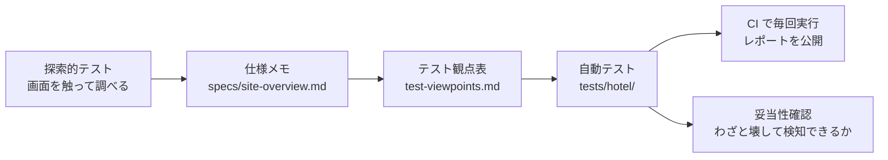

# Playwright Portfolio

[](https://github.com/Tsukimi-0919/playwright-portfolio/actions/workflows/playwright.yml)

Playwright（TypeScript）による E2E テストの学習ポートフォリオです。
仕様書のない Web サイトを**探索的テストで調べて仕様を明らかにし**、そこから**テスト観点を設計して自動化する**までを一通り行いました。

- 📊 最新のテストレポート：https://tsukimi-0919.github.io/playwright-portfolio/
- 📄 仕様メモ：[docs/specs/site-overview.md](docs/specs/site-overview.md)
- 📋 テスト観点表：[docs/test-viewpoints.md](docs/test-viewpoints.md)
- 🧭 テスト戦略：[docs/test-strategy.md](docs/test-strategy.md)
- 🔍 テストの妥当性確認：[docs/test-verification.md](docs/test-verification.md)

## テスト対象

| 対象 | 位置づけ |
|---|---|
| [HOTEL PLANISPHERE](https://hotel-example-site.takeyaqa.dev/ja/) | **メイン**。ホテル予約サイトを模したテスト自動化練習サイト |
| [TodoMVC デモ](https://demo.playwright.dev/todomvc/) | Playwright の基本操作を練習した記録 |

## 進め方



| 工程 | 担当 |
|---|---|
| 探索的テスト・仕様メモ・観点表の設計・期待値の算出 | 自分 |
| テストコードの実装 | 生成 AI（Claude）と協働 |
| 観点表とコードの対応確認・レビュー・実行と原因調査 | 自分 |

テストの「何を・なぜ確かめるか」は自分で決め、実装は AI と協働し、レビューと検証で品質を担保する進め方にしています。

## テストの内容（HOTEL PLANISPHERE：75本）

| 区分 | 内容 | 観点 | テスト |
|---|---|---|---|
| A. 合計金額 | 平日・土日料金、平日と土日の混合、人数、追加プラン、確認画面との一致 | 12 | 12 |
| B. 入力チェック | 宿泊予約・会員登録・ログインの必須チェック、境界値、形式チェック、エラーメッセージ | 19 | 51 |
| C. 会員ランク | 未ログイン／一般／プレミアムで見えるプラン、URL 直接アクセスの制御 | 7 | 9 |
| その他 | 予約画面の表示、確認のご連絡による入力欄の切り替え | — | 3 |

テスト名には観点表の番号（例：`A-11`、`B-2-5`）を付け、レポートから観点表をたどれるようにしています。

## 工夫した点

**テスト設計**
- 仕様が書かれていないサイトを触って調べ、**料金ルールやアクセス制御を自分で明らかにした**
- 「1泊目が高い」と見えた現象を、曜日を変えて切り分け「土日の泊が25%アップ」と特定するなど、**重なった条件を分けて原因を確かめた**
- 境界値分析（下限-1／下限／上限／上限+1）を、範囲の異なる代表3プランで実施
- 現状の挙動と仕様を分け、**改善すべき挙動（例：確認のご連絡だけエラー文言が出ない）はテストで固定しない**

**実装**
- **Page Object Model**（`pages/hotel/`）とテストデータ（`test-data/`）を分離
- 観点表をそのままデータにした**データ駆動テスト**
- 宿泊日は「次の水曜日」のように**曜日で指定**し、実行日や CI のタイムゾーンに結果が左右されないようにした
- 新規ウィンドウ（popup）や非同期読み込みを、固定の待ち時間を使わずに扱う
- ユーザー視点のロケーター（`getByRole` / `getByLabel`）を優先

**品質確認**
- サイトのコピーを手元で動かし、**わざとバグを入れてテストが検知できるか**を確認（[結果](docs/test-verification.md)）
- GitHub Actions で push / PR ごとに実行し、HTML レポートを GitHub Pages に公開

## ディレクトリ構成

```
├── docs/
│   ├── specs/site-overview.md   仕様メモ（探索的テストの結果）
│   ├── test-viewpoints.md       テスト観点表
│   ├── test-strategy.md         テスト戦略・ふり返り
│   └── test-verification.md     テストの妥当性確認
├── pages/hotel/                 Page Object
├── test-data/                   テストデータ（観点表と対応）
├── tests/
│   ├── hotel/                   HOTEL PLANISPHERE のテスト（メイン）
│   └── todomvc/                 TodoMVC の練習
└── playwright.config.ts         プロジェクト（対象アプリ）ごとの設定
```

## 実行方法

```bash
npm ci
npx playwright install chromium

npm test               # すべて実行
npm run test:hotel     # HOTEL PLANISPHERE だけ
npm run test:ui        # UI モードで実行
npm run report         # HTML レポートを開く
```

## 今後やりたいこと

- [ ] マイページ（会員登録した内容が正しく表示されるか）
- [ ] 予約確認画面の表示内容（日付・人数・追加プラン・連絡方法）
- [ ] アクセシビリティチェック（axe）
- [ ] モバイル表示（レスポンシブ）での確認

## 謝辞

テスト対象として [HOTEL PLANISPHERE](https://github.com/takeyaqa/hotel-example-site)（MIT License）を利用しています。
