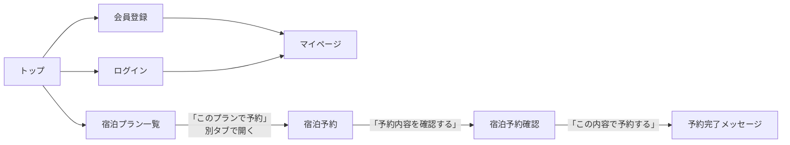

# HOTEL PLANISPHERE 仕様メモ（サイト全体）

> 実際に画面を触って確認した内容をまとめたもの。
> 「要確認」は、まだ確かめていない点や、仕様が曖昧な点。ここからテスト観点を作る。

- 対象：https://hotel-example-site.takeyaqa.dev/ja/
- 調査日：2026-10-10
- 調査方法：探索的テスト（手動）

## 1. サイトの目的

利用者がプランを選び、ホテルの宿泊予約を行う。

## 2. 画面遷移



## 3. 画面ごとの仕様

### 3-1. 宿泊プラン一覧

| 要素 | 内容 |
|---|---|
| プランカード | プラン名と「このプランで予約」ボタン |
| 予約ボタン | 宿泊予約画面を**別タブ**で開く |

**ログイン状態による表示の違い**

| ログイン状態 | 表示されるプラン数 | 追加で見えるプラン |
|---|---|---|
| 未ログイン | 7 | — |
| 一般会員 | 9 | ディナー付きプラン、お得なプラン |
| プレミアム会員 | 10 | 上記＋プレミアムプラン |

（確認アカウント：プレミアム会員、一般会員それぞれでログインして確認）

**URLを直接開いたときの制御**

| プラン | 未ログイン | 一般会員 | プレミアム会員 |
|---|---|---|---|
| プレミアムプラン | 表示されない | 表示されない | 表示される |
| ディナー付きプラン | 表示されない | 表示される | 表示される |

- 「表示される」は一覧から開けることを確認したもの
- 一覧に出ないプランは、予約画面のURL（`reserve.html?plan-id=…`）を直接開いても予約画面は表示されない

- 予約画面が表示されないときは、トップページ（`index.html`）に戻される

### 3-2. 宿泊予約

| 項目 | 必須 | 入力の種類 | 制約（範囲・形式） | 確認方法 |
|---|---|---|---|---|
| 宿泊日 | ✅ | 日付 | 翌日〜90日後 | 手動 |
| 宿泊数 | ✅ | 数値 | プランごとに上限が異なる（下表） | 手動 |
| 人数 | ✅ | 数値 | プランごとに上限・下限が異なる（下表） | 手動 |
| 追加プラン | 任意 | チェックボックス | | |
| 氏名 | ✅ | テキスト | | 手動 |
| 確認のご連絡 | ✅ | 選択 | 選択によって入力欄が変わる？ | |
| ご要望 | 任意 | テキスト | 140文字まで（141文字目以降は入力できない） | 手動 |

#### プラン別の人数・宿泊数

| プラン | 表示条件 | 人数 | 宿泊数の上限 |
|---|---|---|---|
| お得な特典付きプラン | 誰でも | 1〜9人 | 要確認 |
| 素泊まり | 誰でも | 1〜2人 | 9泊 |
| 出張ビジネスプラン | 誰でも | 1〜2人 | 9泊 |
| エステ・マッサージプラン | 誰でも | 1〜6人 | 9泊 |
| 貸し切り露天風呂プラン | 誰でも | 1〜6人 | 3泊 |
| カップル限定プラン | 誰でも | **2〜2人** | 2泊 |
| テーマパーク優待プラン | 誰でも | 1〜9人 | 5泊 |
| プレミアムプラン | プレミアム会員のみ | **2〜9人** | 9泊 |
| ディナー付きプラン | 会員（一般・プレミアム） | 1〜4人 | 3泊 |
| お得なプラン | 会員（一般・プレミアム） | 1〜9人 | 9泊 |

- 人数の下限は、プレミアムプランとカップル限定プランが2人、それ以外は1人
- 宿泊数の下限は要確認（1泊からと思われる）

| 表示要素 | 内容 |
|---|---|
| プラン情報 | 選んだプラン名・部屋のプランを表示 |
| 合計金額 | 入力に応じて表示 |
| 予約内容を確認する | 確認画面へ進む |

#### 合計金額の計算ルール

**1人1泊あたりの料金**

| プラン | 平日 | 土日（25%アップ） |
|---|---|---|
| お得な特典付きプラン | 7,000円 | 8,750円 |
| 素泊まり | 5,500円 | 6,875円 |
| 出張ビジネスプラン | 7,500円 | 9,375円 |
| エステ・マッサージプラン | 9,000円 | 11,250円 |
| 貸し切り露天風呂プラン | 9,000円 | 11,250円 |
| カップル限定プラン | 8,000円 | 10,000円 |
| テーマパーク優待プラン | 10,000円 | 12,500円 |
| プレミアムプラン | 10,000円 | 12,500円 |
| ディナー付きプラン | 8,500円 | 10,625円 |
| お得なプラン | 6,000円 | 7,500円 |

- 土日は25%アップ。会員・非会員で料金は変わらない
- カップル限定プラン：最初は平日6,000円・土日7,500円と記録したが、再確認で8,000円・10,000円と確定（別のプランの画面を見ていた可能性）
- 25%アップするのは**土曜・日曜の泊**（何泊目かは関係ない）
  - 経緯：最初は「1泊目が高い」ように見えたが、初期値の宿泊日が日曜だったため。宿泊日を変えて試し、曜日が原因と確定した

**追加プラン**（単価：1人1,000円）

| 追加プラン | 計算 | 土日割増し |
|---|---|---|
| 朝食バイキング | 1,000円 × 人数 × **宿泊数** | なし |
| 昼からチェックインプラン | 1,000円 × 人数（**1回だけ**） | なし |
| お得な観光プラン | 1,000円 × 人数（**1回だけ**） | なし |

- 3つとも人数に比例して1,000円ずつ増えることを確認
- 経緯：合計だけを見ると追加プランも割増しされているように見えたが、「追加プランあり／なし」の差額で確認し、上記と確定した

計算式：

```
基本料金   = Σ（その泊の1人1泊料金）× 人数    ※ 土日の泊は25%アップ
朝食       = 1,000円 × 人数 × 宿泊数
チェックイン = 1,000円 × 人数
観光       = 1,000円 × 人数
合計       = 基本料金 + 選んだ追加プランの料金
```

**要確認**
- 入力を変えたとき、合計金額はいつ更新されるか
#### 入力チェックとエラーメッセージ

| 項目 | 条件 | チェックのタイミング | 表示 |
|---|---|---|---|
| 宿泊日・宿泊数・人数 | 空欄 | フォーカスを外したとき | 「このフィールドを入力してください。」 |
| 宿泊日 | 今日（当日） | フォーカスを外したとき | 「翌日以降の日付を入力してください。」 |
| 宿泊日 | 明日・90日後 | | エラーなし |
| 宿泊日 | 91日後 | フォーカスを外したとき | 「3ヶ月以内の日付を入力してください。」 |
| 氏名 | 空欄 | 「予約内容を確認する」を押したとき | 「このフィールドを入力してください。」 |
| 確認のご連絡 | 未選択 | 「予約内容を確認する」を押したとき | **枠が赤くなるだけで、メッセージは出ない** |
| ご要望 | 141文字を貼り付け | 入力時 | 141文字目が削られ、140文字で入力される |

**気になる点（改善提案）**
- 確認のご連絡だけ、未選択でもメッセージが出ない。ほかの必須項目と表示がそろっておらず、色だけで伝えているため、色の見分けがつきにくい人には分かりにくい

### 3-3. 宿泊予約確認

| 要素 | 内容 |
|---|---|
| 入力内容 | 宿泊予約画面で入力した内容を表示 |
| 合計金額 | 表示 |
| 予約するボタン | 押すと予約完了のメッセージを表示 |

**要確認**
- 確認画面の合計金額は、予約画面の金額と一致するか
- 予約完了後、画面やタブはどうなるか

### 3-4. 会員登録

| 項目 | 必須 | 入力の種類 | 制約（範囲・形式） | 確認方法 |
|---|---|---|---|---|
| メールアドレス | ✅ | テキスト | メールアドレスの形式／登録済みでないこと／文字数の上限なし | 手動 |
| パスワード | ✅ | パスワード | 8文字以上／上限なし | 手動 |
| パスワード（確認） | ✅ | パスワード | パスワードと一致すること | 手動 |
| 氏名 | ✅ | テキスト | 文字数の上限なし | 手動 |
| 会員ランク | 任意 | 選択 | プレミアム会員／一般会員 | 手動 |
| 住所 | 任意 | テキスト | 文字数の上限なし | 手動 |
| 電話番号 | 任意 | テキスト | 半角数字11桁ちょうど（ハイフン・全角は不可）。入力自体は何桁でもでき、登録時にチェック | 手動 |
| 性別 | 任意 | 選択 | | 手動 |
| 生年月日 | 任意 | 日付 | | 手動 |
| お知らせを受け取る | 任意 | チェックボックス | | 手動 |

**チェックのタイミング**
- Enter キーを押したとき、または登録ボタンを押したときにチェックが動く
- 登録ボタンを押す前は、入力途中でエラーは出ない
- 一度エラーが出たあとは、入力を直すとその場で表示が変わる（正しい値で緑になりエラーが消え、誤った値ではエラーが出る）

**エラーメッセージ**

| 項目 | 条件 | 表示 |
|---|---|---|
| メールアドレス・パスワード・パスワード（確認）・氏名 | 空欄 | 「このフィールドを入力してください。」 |
| メールアドレス | 「@」がない | 「メールアドレスを入力してください。」 |
| メールアドレス | 登録済み | 「このメールアドレスはすでに登録済みです。」 |
| パスワード・パスワード（確認） | 7文字 | 「8文字以上で入力してください。」 |
| パスワード（確認） | パスワードと不一致 | 「入力されたパスワードと一致しません。」 |
| 電話番号 | 10桁・12桁・全角数字・ひらがな | 「指定されている形式で入力してください。」 |

**登録後の動き**
- 正しく入力して登録すると、**マイページに遷移する**
- 登録済みのメールアドレスを入力すると、重複チェックで止まり、遷移しない
  - メールアドレス欄の下に「このメールアドレスはすでに登録済みです。」と表示される
  - 1回目の確認ではこれに該当し、遷移しなかった

**ログイン中の動き**
- ナビゲーションの「会員登録」が「マイページ」に変わる
- 会員登録画面のURL（`signup.html`）を直接開くと、トップページ（`index.html`）に戻される

### 3-5. ログイン

| 項目 | 必須 | 入力の種類 | 制約 | 確認方法 |
|---|---|---|---|---|
| メールアドレス | ✅ | テキスト | | 手動 |
| パスワード | ✅ | パスワード | | 手動 |

**エラーメッセージ**

| 条件 | 表示 |
|---|---|
| 何も入力せずにログイン | メールアドレス・パスワードの両方に「このフィールドを入力してください。」 |
| 登録済みメールアドレス＋誤ったパスワード | メールアドレス・パスワードの両方に「メールアドレスまたはパスワードが違います。」 |

### 3-6. マイページ

ログイン中のユーザー情報を表示する。

| 表示項目 |
|---|
| メールアドレス |
| 氏名 |
| 会員ランク |
| 住所 |
| 電話番号 |
| 性別 |
| 生年月日 |
| お知らせ |

**要確認**
- 会員登録で未入力にした項目は、どう表示されるか
- 会員登録で入力した値が、そのまま表示されるか

## 4. 画面をまたぐ確認ポイント

| 流れ | 確認したいこと |
|---|---|
| 会員登録 → マイページ | 入力した内容が正しく表示されるか |
| 会員登録 → ログアウト → ログイン | 登録したアカウントでログインできるか |
| ログイン → 宿泊予約 | 氏名などが自動で入力されるか |
| 宿泊予約 → 確認 | 入力内容と金額が引き継がれるか |
